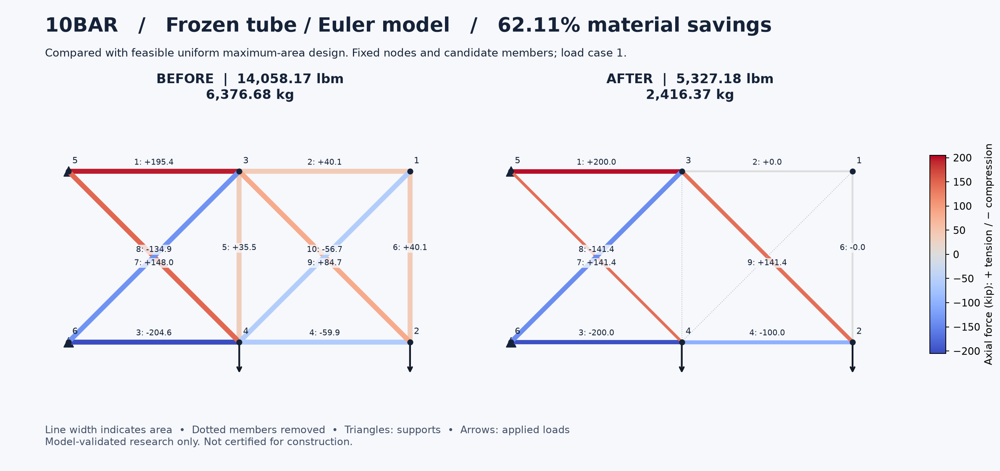
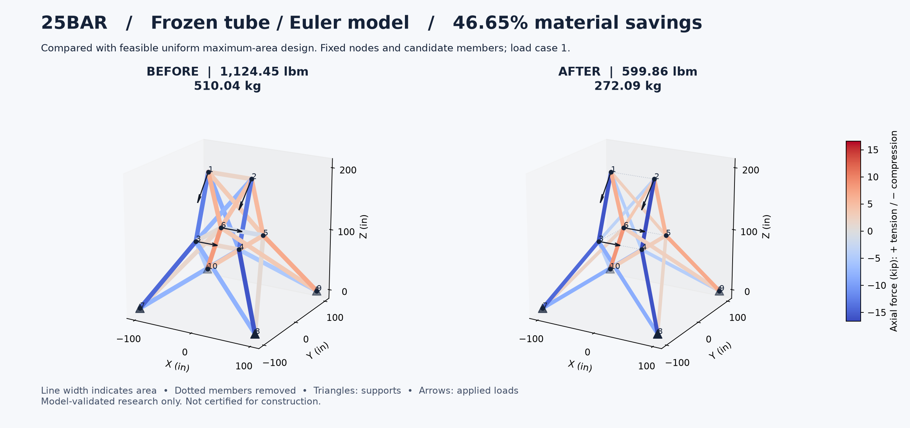
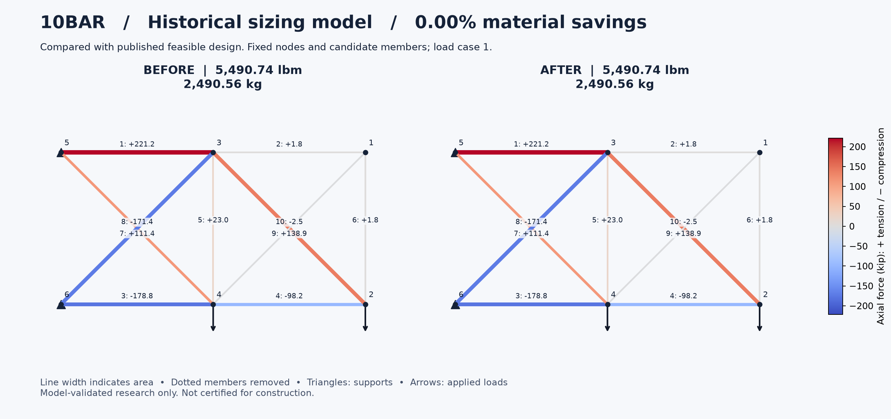
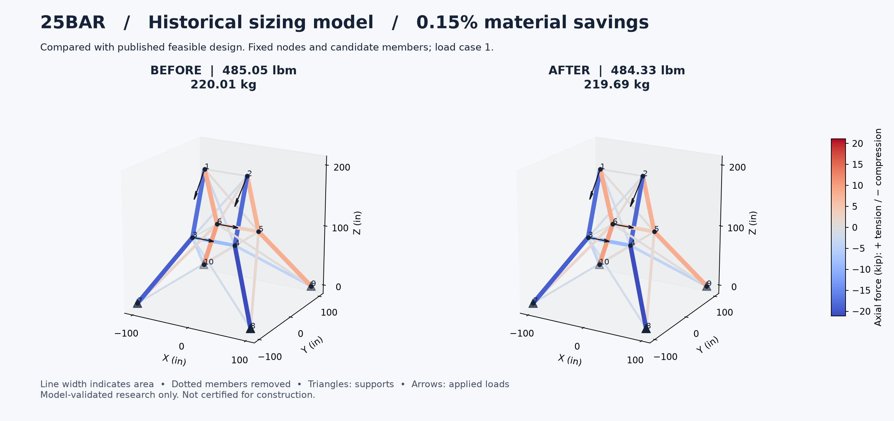
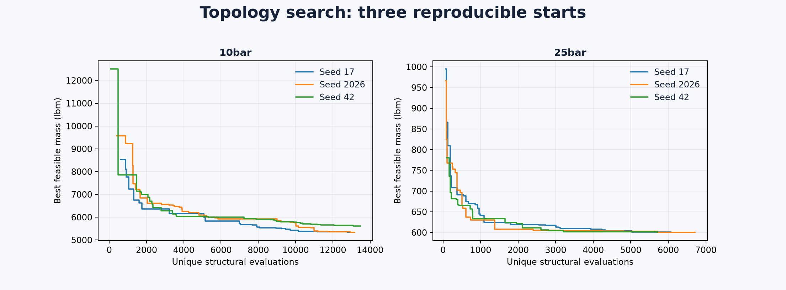

# Verified pilot results

All values below are **author-checked within the frozen model**, not independent human review, global optimality, novelty, or physical certification. Baselines differ by profile and are named explicitly. Three seeds (17, 42, 2026), 120 DE generations, then structured local refinement were used for every row.

| Case / search | Before (lbm) | After (lbm) | After (kg) | Material saved | Before means |
|---|---:|---:|---:|---:|---|
| 10bar / reference | 5490.737892 | 5490.737892 | 2490.556814 | 0.0000% | published feasible vector |
| 10bar / tube-sizing | 14058.166225 | 5692.751321 | 2582.188563 | 59.5057% | feasible uniform maximum areas |
| 10bar / tube-topology | 14058.166225 | 5327.180568 | 2416.368459 | 62.1061% | feasible uniform maximum areas |
| 25bar / reference | 485.048797 | 484.328644 | 219.687778 | 0.1485% | published feasible vector |
| 25bar / tube-sizing | 1124.450414 | 602.553278 | 273.313570 | 46.4135% | feasible uniform maximum areas |
| 25bar / tube-topology | 1124.450414 | 599.860201 | 272.092010 | 46.6530% | feasible uniform maximum areas |

The historical 10-bar baseline was retained. A small 25-bar reference improvement is a local result, not a literature record. Large tube-model percentages mainly measure savings over a deliberately heavy uniform design. They must not be described as improvements over published optima.

| Case | Best sizing-only mass | Best topology mass | Additional topology saving | Removed members |
|---|---:|---:|---:|---|
| 10bar | 5692.751321 | 5327.180568 | 6.4217% | [5, 10] |
| 25bar | 602.553278 | 599.860201 | 0.4469% | [1, 10, 11, 12, 13] |

These are comparisons of the best observed runs, not a proof that topology or a particular algorithm caused the full difference. Run variability matters.

| Case / search | Seed masses (lbm) | Max stress utilization | Max displacement utilization | Max Euler utilization |
|---|---|---:|---:|---:|
| 10bar / reference | 5490.73789, 5490.73789, 5490.73789 | 0.56787713 | 0.99947142 | 0.00000000 |
| 10bar / tube-sizing | 5692.75132, 5843.01831, 5757.68909 | 0.83881487 | 0.99757155 | 0.90974445 |
| 10bar / tube-topology | 5327.18057, 5614.17958, 5327.18057 | 0.78349782 | 0.99560625 | 0.99092420 |
| 25bar / reference | 484.32864, 484.32864, 484.85418 | 0.15489697 | 0.99988652 | 0.00000000 |
| 25bar / tube-sizing | 605.21774, 602.55328, 605.21774 | 0.18772993 | 0.99710605 | 0.99585545 |
| 25bar / tube-topology | 600.59935, 600.19574, 599.86020 | 0.16679522 | 0.99280664 | 0.99273569 |

Utilization <=1 is within the stated constraint. Euler utilization zero in reference rows means **not constrained**, not an infinite buckling margin.
Across the six winners, maximum independent free-equilibrium residual is 9.32e-16 relative to applied force; maximum normalized difference between solvers is 1.55e-15. Global force/moment balance and energy checks are retained in each verification JSON.

## Rendered comparisons

Red is tension and blue compression; the color bar shows signed force. The 10-bar plot annotates member number and force in kip. The spatial plot uses color to avoid unreadable labels; its exact signed forces are in the complete CSV schedules. Before/after panels share a force scale. Crossed members are not joined unless their endpoint node is shared.

## Reproduction and limits

Run `python scripts/reproduce.py` in the pinned environment. `scripts/run_search.py` reconstructs the searches with recorded seeds, algorithm settings and model hashes. Unique evaluations, cache hits, infeasible evaluations, removed-member evaluations, local passes and timings are retained per run. Timings are descriptive: this was not an isolated performance experiment and other machine work may affect them. A clean-checkout run is recorded in `research/pilot/VERIFY.json`.

Two published rows fail the frozen checks; see the literature audit and rejection tests. No source has been silently repaired. The 72-bar follow-on is surveyed only: its geometry and HBB-BC mass are transcribed, but feasibility and a discrete catalogue remain outside the verified portfolio.
