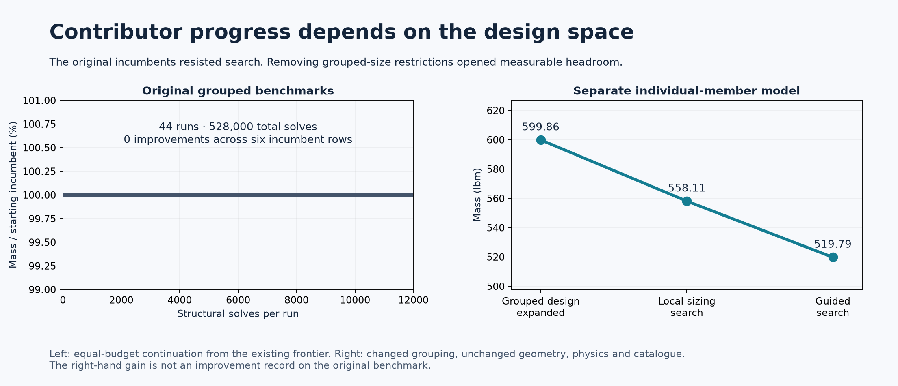
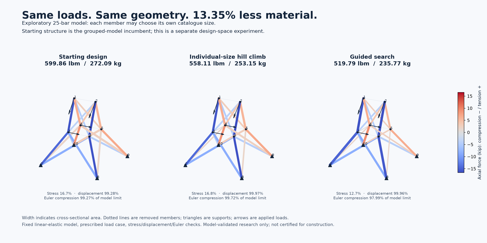
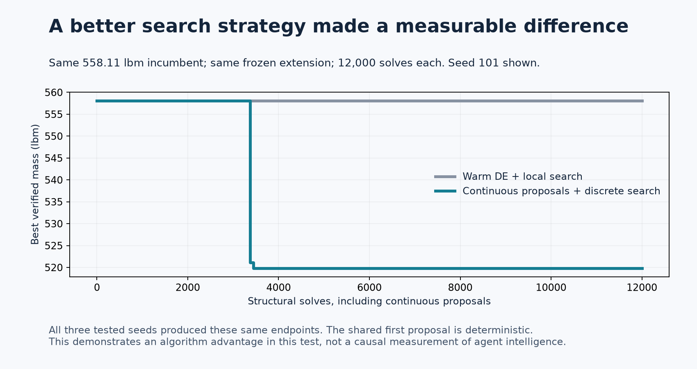

# Featured-pilot contributor trial

**Recommendation: keep lightweight truss design on the shortlist, but do not
feature the current two grouped benchmarks as the ongoing discovery challenge.**
The topic has a clear public story, inexpensive verification, and evidence that
better search strategy matters. The present frontier is too constrained for
reliable early mass improvements. A separately frozen extension produced a
13.35% material reduction, which supports a broader pilot; it also plateaued
quickly in the tested continuation methods. Feature a reviewed family of richer
problems only after fresh contributors demonstrate sustained progress.

The trial took approximately 36 minutes end to end (exact UTC times and checks are in VERIFY.json).
This is a local rehearsal by the same agent that built the pilot, starting from
commit `ed6cba1`, not a blind onboarding study or independent engineering review.
Douglas Colkitt remains the maintainer. Code is MIT; original documentation and
figures are CC BY 4.0. No public intake or publication was initiated.

## What the contributor actually achieved

The starting point was the **current verified frontier**, not a heavy uniform
structure. Fresh source checkout; existing pinned virtual environment. The
original reproduction passed 12 tests and rechecked all 18 saved search runs.
The weighted task picker selected bounded search using recorded seed
`ae59f86324a34a781b86cfa845d99288`.

Two strategies received the same 12,000 structural-solve budget per run: an
incumbent-warmed DE/local-search control and a guided method using continuous
proposals, nearby discrete sections, and topology rank screening. Continuous
solves count toward the guided method's budget. All outcomes were retained.

| Frozen case and variant | Runs | Starting mass, lbm | Best resulting mass, lbm | New gains |
|---|---:|---:|---:|---:|
| 10-bar reference sizing | 6 | 5,490.73789 | 5,490.73789 | 0 |
| 10-bar tube sizing | 6 | 5,692.75132 | 5,692.75132 | 0 |
| 10-bar tube topology | 10 | 5,327.18057 | 5,327.18057 | 0 |
| 25-bar reference sizing | 6 | 484.32864 | 484.32864 | 0 |
| 25-bar tube sizing | 6 | 602.55328 | 602.55328 | 0 |
| 25-bar tube topology | 10 | 599.86020 | 599.86020 | 0 |

**44 seeded runs, 528,000 structural solves, no improved incumbent.** Those are
algorithm runs within one contributor session, not 44 people or independent
sessions. The initial pilot's much larger savings against uniform structures
remain valid setup results, but cannot be advertised as progress from this trial.

Positive controls from weaker seed-42 designs improved by 0.1907% on 10-bar and
0.0559% on 25-bar with the guided method; the ordinary continuation control did
not improve them. Neither beat the starting frontier. This demonstrates that a
small hill climb can exist while the live frontier remains resistant.

## An explanation for the plateau

There are fewer effective choices than the pictures suggest. An exact integer
rank audit found **40 nonsingular grouped layouts out of 1,024** for 10-bar, and
**12 out of 256** for 25-bar. The latter has 25 members but only eight tied sizing
groups. Nonsingular means full-rank restrained linear stiffness, not a physically
safe structure or a feasible design under every constraint.

Reasoning about equilibrium also reduced the search problem substantially:

- All 45 eight-member subsets of the 10-bar structure were screened and the
  admissible discrete section problems solved as numerical MILPs. The best
  matched the incumbent. This covers the determinate subset only.
- The 25-bar incumbent topology has two independent self-stress coordinates.
  A force-method implementation exhausted all **24.3 million** catalogue
  assignments on that topology in about 127 seconds: 3.418 million mass-pruned,
  20.882 million evaluated in the reduced system, no lighter feasible design.
  A separate displacement-based MILP also returned the incumbent with numerical
  zero gap. These are fixed-topology results, not global topology certificates.
- The reduced implementation agreed with 100 random designs checked by the
  untouched separately coded solver: maximum force difference about
  1.13e-10 lbf and normalized displacement difference 9.42e-14.
- Global/fixed-topology MILP attempts on the remaining 10-bar possibilities
  retained unresolved timeouts. We did **not** prove global optimality.

This is useful contributor work—diagnosing a plateau and developing auditable
bounds—but it is a poor substitute for repeated visible mass improvements if
that is the main promise to early donors. Floating-point enumeration and MILP
status are numerical evidence, not formal interval-certified proofs.

## A separate design-space experiment worked

To test whether the *topic*, rather than the narrow benchmark, has promise, we
froze a new model before optimizing: same 25-bar nodes, candidate members, loads,
material, discrete section catalogue, tolerances and structural checks, but
**25 independently sized members instead of eight tied groups**. Both existing
structural engines were used unchanged. The model has its own ID/hash/baseline
and has not been accepted into the original frontier.

| Sequential stage in the separate model | Mass, lbm | Change from prior stage |
|---|---:|---:|
| Original winning physical structure, expanded to individual variables | 599.86020 | — |
| Coordinate reductions and paired exchanges | 558.10710 | −6.9605% |
| Continuous proposals followed by discrete search | 519.79068 | −6.8654% |

**Total: 13.3480% less material**, or 80.07 lbm / 36.32 kg, within the new
idealized model. This is not a new record on the original grouped benchmark.
The first hill climb used 38,908 evaluations and about 77 seconds. From its
558.11 lbm result, the warm DE/local control found no gain in three 12,000-solve
runs. The guided method reached 519.79 lbm in all three corresponding runs,
about 4.7–8.7 seconds each. Its successful initial proposal is deterministic;
three seeds are a repeatability check, not three independent discoveries.

A second sequential round from 519.79 lbm used the same two methods, three seeds
each, and another 72,000 solves. Neither method improved it. This is evidence
for a short, satisfying burst of progress, **not yet evidence of a durable
community discovery frontier**. There may be better designs; this test did not
establish the global optimum or exhaust the independent-member design space.

The final design passes both engines. Maximum normalized utilization is
0.12682 for axial stress, 0.99960 for displacement, and 0.97987 for the specified
Euler compression constraint; free-DOF equilibrium residual is 1.30e-15 relative
to the load scale. Maximum recorded cross-engine relative difference is
9.22e-16. These numbers verify the specified mathematical model, not physical
safety. Individual sizing also increases the number of distinct retained section
sizes from **four to sixteen**. That exposes a practical manufacturing tradeoff
that a mass-only objective ignores.

## Assessment against the feature criteria

| Criterion | Judgment | Evidence and limit |
|---|---|---|
| Tangible early hill climbing | Weak in current pilot; promising after expansion | Zero original-frontier gains; two meaningful extension steps, followed by a plateau. |
| Public explanation and imagination | Strong concept; moderate current visual impact | “Carry the same loads using less material” is immediate. Color forces and show shrinking sections. Fixed nodes mean no dramatic shape transformation. No actual audience test was run. |
| Meaningful research outcomes | Useful methods and validation; novelty unestablished | Bounds, solver checks and constraint-aware strategies are real outputs. Classic benchmark mass improvements alone are unlikely to establish new engineering science. |
| High-end home PC suitability | Strong for tested cases | All work ran CPU-only on an 8-core Apple M2 with 24 GiB RAM. Winner searches took seconds to minutes. Large future models are unmeasured. |
| Agent intelligence matters | Plausible, with a concrete example | Reformulating via self-stress and selecting continuous-to-discrete proposals helped. The guided method beat the chosen control from a common start. Standard algorithms performed the calculations; this is not proof that an agent beats a well-tuned optimizer or expert. |
| Continuing donor discovery | Not ready | A tiny finite suite can exhaust easy wins. Independent review and a richer, motivated instance family are needed before promising recurring progress. |

The key opportunity for an agent is to inspect failures, distinguish displacement
from buckling limits, choose useful coordinated changes, exploit equilibrium
structure, and communicate a reproducible contribution. Running more copies of
a fixed optimizer is a weaker proposition. The extension's guided win is also a
warning: once that strategy is supplied, it becomes the baseline that the *next*
contributor must beat.

A primary benchmark study already shows how much truss-optimizer comparisons can
depend on algorithm settings; our control is useful but not the strongest
possible classical baseline. See [Dillen, Lombaert and Schevenels (2021)](https://www.frontiersin.org/journals/built-environment/articles/10.3389/fbuil.2021.618851/full).
We do not compare our added tube/Euler models numerically with differently
constrained literature optima. Reproducible goals, problem selection and fair
budgets are central to [optimization benchmarking best practice](https://arxiv.org/abs/2007.03488v2).

## What I would require before featuring it

Use the classic 10/25-bar cases as tutorials and regression checks. Make the
live challenge a **versioned portfolio** of reviewed engineering questions, with
an explicit reason for each additional freedom or constraint. Candidates include
independent member sizing, multiple load directions, material-versus-section-count
tradeoffs, and modestly larger ground structures. The researched 72-bar case still
needs its own pinned discrete definition and replication; it was not tested here.
Do not change model rules mid-leaderboard or manufacture progress with weak starts.

A concrete launch gate would be 8–12 frozen portfolio cases, a strong published
baseline bundle including this guided method, then 5–10 fresh contributor sessions
starting from those live incumbents. Pre-register practical success thresholds
—for example, a material improvement around 0.5–1% on some cases, or a clearly
useful tighter bound or verified counterexample—and retain all failures. Measure
whether contributions keep arriving over several sequential rounds, not just a
first burst. Those counts and thresholds are proposed product gates, not observed
success rates or mathematical requirements.

Separately have an unaffiliated reviewer audit the physics, units, sources and
both solvers; test the public demo with actual non-specialists. Show material
savings alongside model checks and section-count tradeoffs. Give credit for
reproducible negative results, cheaper verification and bounds in a separate
contribution category. Avoid presenting tutorial progress as a live research win.

For practical transfer, mass-only, linear pin-jointed models omit connection
mass/cost, joint behavior, fabrication, uncertainties, imperfections, nonlinear
and global instability, fatigue and fuller load combinations. The valuable
near-term deliverable is a tested optimization/verification method and an audited
design-space study. Construction designs require a separate engineering and
physical-validation program. **Nothing here is certified for construction.**

## Artifacts and limitations

[Methods and replay commands](METHODS.md), [pre-experiment plan](PLAN.md),
[machine-readable outcomes](artifacts/trial-summary.json),
[verification receipt](VERIFY.json), and [separate best candidate](extension/best-verified.json)
provide the evidence. All 76 saved candidate reports and 40 improving trace points were
rechecked against both structural implementations. A clean checkout also passed
12 original tests and four method tests, replayed the successful guided search
exactly, and repeated the full 24.3-million fixed-topology enumeration with the
same counts and outcome (about 73 seconds without the earlier concurrent load). Original benchmark/model and
verifier files are unchanged; the original frontier is unchanged.

Timing includes research, implementation, execution, interpretation, rendering
and validation; jobs overlapped, so per-run times must not be added to infer total
wall time. The original reproduction alone took 1.06 seconds wall time and about
50.7 MiB peak RSS under `/usr/bin/time -l`. A live MILP process was observed around
113 MiB RSS, but peak memory for the entire trial was not instrumented. Dependencies
were reused, so fresh-install friction was not measured. GPU hardware was unused.

The trial is one informed agent session, with no independent human reviewer,
no blind novice onboarding, no public-interest test, no statistical estimate of
future donor success, and no claim of global optimality. These limits are why the
recommendation is conditional despite the encouraging extension result.
